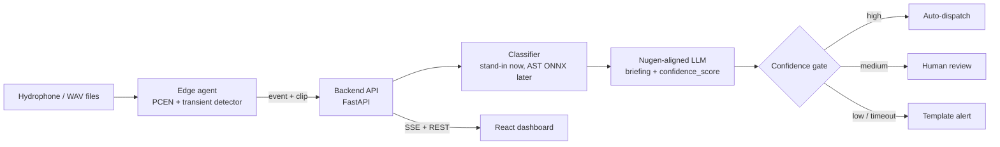

<div align="center">

# 🌊 BluePulse

### Hear the reef before it breaks.

**AI bioacoustic monitoring that detects blast fishing and tracks reef health, with briefings written by a Nugen-aligned language model.**

    

*AI for Climate Change · marine conservation*

</div>

---

## ✨ What it does

Hydrophones record the reef. A small **edge agent** removes ocean noise and flags sudden sounds. The cloud **classifies** each one (blast, vessel, biology, noise), a **Nugen-aligned model** writes a ranger briefing with a confidence score, and a **confidence gate** decides whether to dispatch, ask a human, or send a template alert. Everything the model says is logged for provenance.

> ✅ **Requirement:** inference must run through a Nugen-aligned model. Set `LLM_PROVIDER=nugen` and check that `/v1/provenance` shows your model id.

## 🧭 How it fits together



## 🗂️ Project structure

```
bluepulse/
├── frontend/        React 19 + Vite 8, 5 pages: Home (underwater landing), Command center, Reef health, Evidence, How it works
│   └── src/   App (router), pages.jsx, components/ WaterCanvas, Spectrogram, Dashboard, Provenance
├── backend/         FastAPI service: ingest, classify, Nugen client, provenance, SSE  (+ tests)
├── edge/            Edge agent: watch a folder of WAVs, detect, buffer (SQLite), upload  (+ tests)
├── core/            numpy/scipy signal library: PCEN, mel, detector, indices, TDOA, reef health  (+ tests)
├── nugen/           Corpus (13 docs), training pairs, benchmark, helper CLI, step-by-step guide
├── ml/              DATASETS.md (verified links), prepare_clips, manifest, AST training, ONNX int8 export
├── scripts/         demo_replay.py: reproducible demo events for the video
├── docs/            Prompt for Person B and design notes
├── DEPLOY.md        Deployment guide (Render + Nugen)
├── VIDEO_SCRIPT.md  3-8 min demo video script mapped to the 5 judging criteria
├── data/            Put real audio here (git-ignored)
├── render.yaml      Render blueprint (free tier)
├── START_HERE.md    ⭐ Step-by-step guide from start to finish
└── .env.example
```

## ✅ Status (honest) — full table: [`docs/ROADMAP_STATUS.md`](docs/ROADMAP_STATUS.md)

| Part | State | Verified |
|---|---|---|
| Signal library `core/` | Working | 5 automated tests |
| Edge agent `edge/` | Working (upload mocked in its tests) | 3 tests, plus end-to-end with backend |
| Backend `backend/` | Working, SQLite storage, Telegram + Brevo alerts (mocked in tests, never sent live by the author) | 7 tests incl. edge → backend, LLM fallback, Nugen stream parsing, alerts |
| React frontend | Builds, server-renders, wired to backend | Build + render check. **Animations not yet viewed in a browser by the author** |
| Nugen model | Deployed and answering | Manual test; briefing quality still weak, see `nugen/NUGEN_GUIDE.md` |
| AST training / ONNX export | Scripts written | **Not run** (needs Colab + real audio) |
| Real training audio | **Missing** (not downloadable from the build environment) | Verified links + tested clip tool: `ml/DATASETS.md` |
| Postgres, user login, job queue | **Missing** (Person B) | `docs/PERSON_B_PROMPT.md` |

## 📦 Launch checklist
1. Follow [`DEPLOY.md`](DEPLOY.md) (live URLs, `provider: nugen`).
2. Record the video with [`VIDEO_SCRIPT.md`](VIDEO_SCRIPT.md).
3. Keep evidence: Nugen model page, credits, provenance export.

## 🚀 Quick start (Windows PowerShell)

```powershell
# 1. Python side
pip install numpy scipy soundfile pytest fastapi uvicorn httpx requests
pytest core/tests edge/tests backend/test_app.py ml/test_prepare.py          # expect: 18 passed

# 2. Backend (use fake LLM first, no credits spent)
cd backend
$env:SENSOR_KEYS="s1:secret"; $env:LLM_PROVIDER="fake"
uvicorn app:app --port 8000

# 3. In a second terminal: send a synthetic blast through the whole pipeline
cd ..
$env:PYTHONPATH="core;edge"
python -c "from bluepulse_core import synth_blast; from scipy.io import wavfile; wavfile.write('test.wav',16000,synth_blast(16000,6,3.0))"
python -m bluepulse_edge.agent replay test.wav --api http://localhost:8000 --key secret --sensor s1 --lat 16.05 --lon 73.46
# then open http://localhost:8000/v1/events and /v1/provenance

# 4. Frontend (needs Node 22.12+ or 24)
cd frontend; npm install; copy .env.example .env; npm run dev
```

Switch to the real model: `$env:LLM_PROVIDER="nugen"; $env:NUGEN_API_KEY="..."; $env:NUGEN_MODEL_ID="model_..."`.

## 🔌 API

| Method | Route | Purpose |
|---|---|---|
| POST | `/v1/ingest/events` | Edge → cloud event (header `X-Sensor-Key`), idempotent on `event_id` |
| POST | `/v1/ingest/heartbeat` | Per-minute acoustic indices |
| GET | `/v1/events` | Recent events with briefing, confidence, severity |
| GET | `/v1/provenance` | Every LLM call: provider, model id, latency, confidence, outcome |
| GET | `/v1/stream` | Server-sent events for live dashboards |
| POST | `/v1/events/{id}/review` | Human review decision |
| GET | `/v1/system/info`, `/healthz` | Active provider; liveness |

## 🧠 Nugen in 6 lines

1. Upload the `.txt` files in `nugen/corpus/` (each must be 500+ words: `python nugen/check_corpus.py`).
2. Align on **Qwen2.5-1.5B-Instruct** (Instant Deploy), deploy, copy the model id.
3. Call `…/api/v3/inference/chat/completions` (the endpoint streams `confidence_score` events; the backend parses both stream and JSON).
4. Calibrate the confidence gate on your own numbers, don't trust the defaults (80 / 50).
5. Keep screenshots, credit log and the `/v1/provenance` output as evidence.
6. Details and troubleshooting: [`nugen/NUGEN_GUIDE.md`](nugen/NUGEN_GUIDE.md).

## ☁️ Deploying on Render (free)

Use `render.yaml`, or create a Web Service (`backend`) and a Static Site (`frontend`, publish `dist`). Free tier limits: sleeps after 15 min idle, 512 MB RAM, **no persistent disk, so the SQLite file resets on restart**. Move to Neon Postgres before real use.

## 🛠️ Troubleshooting

| Problem | Fix |
|---|---|
| Upload to Nugen fails | A `.txt` is under 500 words: run `python nugen/check_corpus.py` |
| Dashboard says "Demo data" | Backend not running or wrong `VITE_API_URL` |
| `401 bad sensor key` | `--key` must match `SENSOR_KEYS` (`s1:secret`) |
| Nugen call falls back to template | Timeout over 8 s or bad key/model id: see `/v1/provenance` outcome |
| Import errors in tests | Run from the repo root with `pytest core/tests edge/tests backend/test_app.py` |

## ⚖️ Ethics and limits

Alerts are leads, not verdicts: a human reviews uncertain events and no alert should accuse a person. Reef scores are relative to each site's own baseline, not a health diagnosis. Training data licences must be recorded in a `DATA_CARD.md`, and results on synthetic blasts must be reported separately from real ones.
